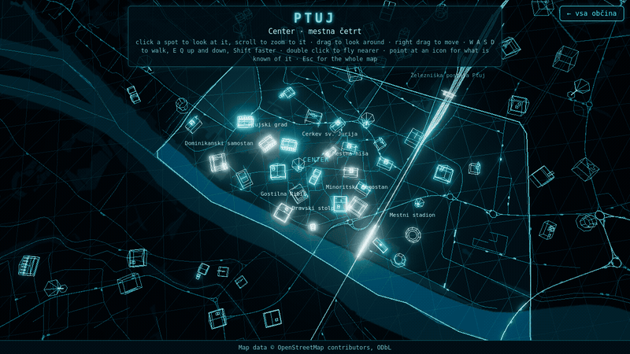

# threejs-landscapes

[](https://github.com/aljazmc/threejs-landscapes/actions/workflows/ci.yml)
[](https://github.com/aljazmc/threejs-landscapes/actions/workflows/publish-ptuj.yml)
[](https://github.com/aljazmc/threejs-landscapes/actions/workflows/publish-bloodmoon.yml)
[](https://github.com/aljazmc/threejs-landscapes/actions/workflows/publish-hullbreach.yml)
[](https://github.com/aljazmc/threejs-landscapes/actions/workflows/publish-moonshadow.yml)
[](LICENSE)
[](https://threejs.org/)
[](https://r3f.docs.pmnd.rs/)
[](https://www.blender.org/)
[](https://www.fluidsynth.org/)
[](https://numpy.org/)
[](https://www.typescriptlang.org/)
[](https://yarnpkg.com/)
[](#requirements)
[](https://github.com/astral-sh/ruff)
[](https://www.shellcheck.net/)
[](https://www.conventionalcommits.org/)

Three first person shooters and a neon map of Ptuj in [three.js](https://threejs.org/), playable in the browser on desktops and phones: [Bloodmoon Manor](https://aljazmc.github.io/bloodmoon-preview/), [Hull Breach](https://aljazmc.github.io/hullbreach-preview/), [Moonshadow Keep](https://aljazmc.github.io/moonshadow-preview/) and the [map of Ptuj](https://aljazmc.github.io/ptuj-preview/). Every model, texture, sound and piece of music is made by the Blender, FluidSynth and Pillow scripts beside the code, and the map comes from OpenStreetMap and elevation data.

It is a Yarn monorepo and a scrapyard of experiments, for half-baked ideas, quirks and programming approaches, and to give scrapped assets another life. Each package in `packages/` is a static browser app, built with esbuild and published to its own `<package>-preview` repository on GitHub Pages together with its README, which is written for the people who play or use it.

## Packages

| Package                           | What it is                                                                                                                               | Live                                                                |
| --------------------------------- | ---------------------------------------------------------------------------------------------------------------------------------------- | ------------------------------------------------------------------- |
| [ptuj](packages/ptuj)             | A neon vector map of the Municipality of Ptuj with its quarters, rivers, roads, railway, landmarks and simulated road and train traffic. | [ptuj-preview](https://aljazmc.github.io/ptuj-preview/)             |
| [bloodmoon](packages/bloodmoon)   | Bloodmoon Manor: a first person shooter in Victorian gothic style, against ten creatures of the night in a vampire's castle.             | [bloodmoon-preview](https://aljazmc.github.io/bloodmoon-preview/)   |
| [hullbreach](packages/hullbreach) | Hull Breach: a first person shooter in cyberpunk style, against ten alien boarders of a spaceship.                                       | [hullbreach-preview](https://aljazmc.github.io/hullbreach-preview/) |
| [moonshadow](packages/moonshadow) | Moonshadow Keep: a first person shooter in elven fantasy style, against ten monsters in an elven keep.                                   | [moonshadow-preview](https://aljazmc.github.io/moonshadow-preview/) |
| [starter](packages/starter)       | A minimal React Three Fiber scene, the template for new packages. Not published.                                                         |                                                                     |



## Development

### Requirements

Only Docker and Bash. Node and Yarn run in the `aljazmc/corepack-alpine` container, which `project.sh` sets up:

```sh
./project.sh start   # writes docker-compose.yml, installs the dependencies and serves the ptuj production build
./project.sh clean   # removes the container, node_modules, the builds and the generated docker-compose.yml
```

`docker-compose.yml` is generated and gitignored. On GNU/Linux, `start` also sets the container's user to yours so files it writes stay yours. Every Yarn command then runs as:

```sh
docker compose run --rm node yarn <script>
```

### Scripts

| Script                   | What it does                                                                                                                                                                         |
| ------------------------ | ------------------------------------------------------------------------------------------------------------------------------------------------------------------------------------ |
| `s:<package>`            | development server                                                                                                                                                                   |
| `w:<package>`            | development server that rebuilds on changes                                                                                                                                          |
| `sp:<package>`           | production build, served                                                                                                                                                             |
| `b:<package>`, `b:all`   | development build into `packages/<package>/dist/`                                                                                                                                    |
| `bp:<package>`, `bp:all` | production build into `packages/<package>/dist/`                                                                                                                                     |
| `ct:<package>`, `ct:all` | type check                                                                                                                                                                           |
| `test`                   | the TypeScript unit tests in `packages/*/tests/ts/unit/*.test.ts`, run in Node                                                                                                       |
| `e2e`                    | the end-to-end tests in `packages/*/tests/ts/e2e/*.e2e.ts`, run with [Playwright](https://playwright.dev/) in Chromium against the development servers (`./project.sh e2e`)          |
| `perf`                   | the load and frame times of every package in Chromium, one at a time (`tests/e2e/performance.e2e.ts`), into `.cache/performance/`                                                    |
| `lint`, `lint:w`         | lint and format check ([lintero](https://www.npmjs.com/package/@aljazmc/lintero) and [formatero](https://www.npmjs.com/package/@aljazmc/formatero)), and the same with fixes written |

The formatter, the linter, the test runner and the release tool (formatero, lintero, testero and monorepo) are developed in [aljazmc](https://github.com/aljazmc/aljazmc), a monorepo of dependency-free TypeScript tools.

The development builds bundle every dependency. The production builds leave out three.js (and React for ptuj and starter) and load them from [esm.sh](https://esm.sh/) through the import map in each package's `src/prod/index.html`. When dependencies are updated, those pinned versions must match the root `resolutions`.

The unit tests import only modules that don't need the DOM. Neither they nor the end-to-end tests are type checked: the package tsconfigs include only `src`.

The end-to-end tests need browsers, which the Node container doesn't have. `./project.sh e2e [args...]` runs `yarn e2e` in the `mcr.microsoft.com/playwright` image of the installed Playwright version, for example `./project.sh e2e --project=ptuj` for one package. `playwright.config.ts` starts each package's `s:<package>` development server on its own port (8101 to 8105).

`yarn perf` (`PERFORMANCE=1 ./project.sh e2e --project=performance --workers=1` from the host) measures each package after a warm-up: the time from the navigation to the first drawn frame, and the mean, 95th percentile and slowest frame times. WebGL runs on SwiftShader, on the CPU, so the games, which draw their menu at the high quality, take about a second a frame there. The budgets only catch a page that stops loading or drawing; CI puts the table into the job summary and keeps the numbers as the `performance` artifact, to follow the trend.

### Code style

TypeScript 7, strict, with `exactOptionalPropertyTypes`, `noUncheckedIndexedAccess` and `verbatimModuleSyntax`. 4 space indents, double quotes, semicolons, trailing commas and 80 columns (`formatero.config.ts`). Run `yarn lint:w` after every change and keep its fixes.

Each package's `tsconfig.json` extends the root one and keeps `"emitDeclarationOnly": true` and `"noEmit": false`, because TypeScript 7 refuses referenced composite projects that disable emitting (TS6310). Check the whole solution with `tsc -b` on the root.

### Python tests

Every package has its TypeScript unit tests in `tests/ts/unit/`, its end-to-end tests in `tests/ts/e2e/` and its Python tests, `tests/py/unit/test_*.py`, beside them. The Python tests use `unittest` from the standard library and run on the host, not in the Node container:

```sh
python3 pytests.py [package...]                                                    # skips the tests that need Blender
blender -b --factory-startup --python-exit-code 1 -P pytests.py -- [package...]    # all of them
./project.sh pytests [image...]                                                    # in the aljazmc/* Docker images
```

CI runs only `python3 pytests.py` with numpy, with no Blender or FluidSynth on the runner. `./project.sh pytests` runs them all in `aljazmc/blender-alpine` and `blender-debian` (inside Blender), and in `inkscape-alpine`, `inkscape-debian`, `fluidsynth-alpine` and `fluidsynth-debian` (with their Python, skipping the Blender tests). `pytests.py` runs each package in a process of its own, because the packages' scripts share module names.

| Package    | `tests/py/unit`     | Checks                                                                                                                                | Needs   |
| ---------- | ------------------- | ------------------------------------------------------------------------------------------------------------------------------------- | ------- |
| bloodmoon  | `test_castlemap.py` | `src/res/gothic-map.txt` is what `castlemap.py` writes now; the props have models; the player and the ten monsters stand on the floor | —       |
| hullbreach | `test_sounds.py`    | every sound effect is a clean mono signal within ±1 and byte for byte its committed WAV                                               | numpy   |
| moonshadow | `test_monsters.py`  | the ten monsters, built in Blender, keep the joints of `ANIMATED`, and `rig.ts` moves every one                                       | Blender |
| ptuj       | `test_bans.py`      | `ban()` marks a place only when its address and a distinctive word of the employer's name match, never by the address alone           | —       |
| starter    | `test_package.py`   | the package is wired into the monorepo; it reads its own folder name, so a copy of the starter passes too                             | —       |

### Script checks

The shell and Python scripts are checked in CI with [ShellCheck](https://www.shellcheck.net/) and [Ruff](https://docs.astral.sh/ruff/) (`ruff.toml`: pyflakes, pycodestyle errors, sorted imports and bugbear, no line length). Neither runs in the Node container; run them from the repository root with Docker:

```sh
docker run --rm -v "$PWD:/mnt" -w /mnt koalaman/shellcheck:stable $(git ls-files '*.sh')
docker run --rm -u "$(id -u):$(id -g)" -v "$PWD:/io" -w /io ghcr.io/astral-sh/ruff:0.17.6 check .        # --fix to fix
```

`tests/sh/wrong-input.sh`, also run in CI, is a table of wrong and missing arguments to the root `project.sh`, the shooters' and ptuj's `project.sh` and `pytests.py`, each with the exit code and the message it must end with. The commands that would need Blender, FluidSynth or Python run with a `PATH` without them, so nothing is built, fetched or rendered. The root `project.sh` runs only its own functions (`clean`, `compose`, `composehack`, `e2e`, `node`, `pytests`, `start`) and prints its usage otherwise.

Keep `# isort: split` in `shooter-scripts/blender/exportglb.py`: `common` has to be imported before `shooter`, because it puts the package's own modules first on the path.

### Generated files

Generated files are committed. Rebuild them on the host (not in Docker) with each package's scripts, and edit the scripts, never their output. The shooters' `./project.sh` only sets the package's theme and runs [`shooter-scripts/project.sh`](shooter-scripts/project.sh), with the Blender and FluidSynth code they share in `shooter-scripts/blender/` and `shooter-scripts/fluidsynth/`. A package's `blender-scripts/` and `fluidsynth-scripts/` hold only its theme, its level layout, its creatures and one project directory per asset.

| Package                           | Command                               | Needs                                  | Makes                                                                                                                            |
| --------------------------------- | ------------------------------------- | -------------------------------------- | -------------------------------------------------------------------------------------------------------------------------------- |
| bloodmoon, hullbreach, moonshadow | `./project.sh graphics`               | Blender                                | `src/res`: the map from the package's layout module, the textures and GLB models from `blender-scripts/<theme>-<name>/<name>.py` |
| bloodmoon, hullbreach, moonshadow | `./project.sh audio`                  | Python with numpy, FluidSynth, ffmpeg  | `src/res`: the sound effects and music from `fluidsynth-scripts/<theme>-<name>/` (OGG, and WAV or MP3 for Safari)                |
| hullbreach                        | `./project.sh font <font.fnt>`        | Python with Pillow                     | `src/res/shooter-font.*` from `pillow-scripts/font.py`: Pixel Operator with č, š, ž, ą, ł…                                       |
| ptuj                              | `inkscape-scripts/project.sh fetch`   | Python                                 | downloads the OpenStreetMap data and the ESS list of bans into `inkscape-scripts/osm/data`                                       |
| ptuj                              | `inkscape-scripts/project.sh map`     | Python                                 | `src/map/ptuj.json`                                                                                                              |
| ptuj                              | `inkscape-scripts/project.sh terrain` | Python with Pillow                     | `src/map/terrain.json` from Terrarium elevation tiles, cached in `osm/data/terrain`                                              |
| ptuj                              | `inkscape-scripts/project.sh all`     |                                        | `fetch`, `map` and `terrain`                                                                                                     |
| ptuj                              | `inkscape-scripts/project.sh preview` | Firefox, ffmpeg, a `yarn b:ptuj` build | `preview.gif`, recorded close up over the old town in headless Firefox                                                           |

`python3 packages/ptuj/inkscape-scripts/osm/bans.py packages/ptuj/inkscape-scripts/osm/data` lists which places match the list of bans. A place matches only when its post code, street, house number **and** a distinctive word of the employer's name all match. Matching on the address alone would mark the wrong places, because several firms share buildings. Places that are confirmed but can't be matched from their tags go in `KNOWN` in `bans.py`.

### Layout

```
shooter-scripts/           asset scripts shared by the three shooters
├── project.sh            graphics | audio | font, run by each shooter's ./project.sh
├── blender/              common.py, export*.py, saveblend.py, shooter.py, creatures.py
└── fluidsynth/           common.py, export.py, song.py, sound.py

packages/<package>/
├── src/index.html        development page
├── src/prod/index.html   production page with the esm.sh import map
├── src/index.css
├── src/…                 the app (the shooters: src/game/, generated src/res/; ptuj: generated src/map/)
├── tests/ts/unit/        TypeScript tests of the DOM-free modules, run by testero in Node
├── tests/ts/e2e/         end-to-end tests of the app in Chromium, run by Playwright
├── tests/py/unit/        Python tests of the package's scripts, run by pytests.py
├── README.md             for players and users, published with the app
└── LICENSE             (the shooters; the others use the root one)
```

[`CLAUDE.md`](CLAUDE.md) describes every package's modules in detail.

## Releases

Commits follow [Conventional Commits](https://www.conventionalcommits.org/) (`feat:`, `fix:`, `chore:`, `docs:`, `refactor:`). Don't bump versions or write `version:` commits by hand.

1. **CI** ([`ci.yml`](.github/workflows/ci.yml)) checks the shell and Python scripts with ShellCheck and Ruff and runs the lightweight Python tests (`python3 pytests.py` with numpy: the Blender tests skip, and nothing is rendered or played) and `tests/sh/wrong-input.sh`, then runs `ct:all` and `b:all` on Node 24, 25 and 26 for every push and pull request to `main`, and `lint`, `test`, `e2e` and `perf` on Node 26.
2. On a push to `main`, the Node 26 run versions every package changed since its last version, and the root, with [`@aljazmc/monorepo`](https://www.npmjs.com/package/@aljazmc/monorepo) (`monorepo.config.ts`; a `refactor` releases a patch). It commits and tags each one as `@aljazmc/<package>@<version>` and pushes them. Then it makes a GitHub release of the last tag of each package that has none yet, with notes from the conventional commits since the tag before that changed the package, by kind, and a link to its preview ([`.github/scripts/release.ts`](.github/scripts/release.ts), tested in `.github/scripts/tests/`).
3. For every package whose new version isn't tagged in its preview repository yet, it starts `publish-<package>.yml`. That workflow builds the tag with `bp:<package>`, checks the build, and commits `dist/` with the README and LICENSE (and ptuj's preview) onto the history of `aljazmc/<package>-preview` as tag `v<version>`, where GitHub Pages serves it ([`.github/actions/preview`](.github/actions/preview/action.yml)), so every published version stays there. Pushing there needs the `GH_TOKEN` secret.

A publish can also be started by hand from the Actions tab, with a version (empty for the branch) and `force` to publish again a version that is already there, as a new commit with the tag moved to it.

[Dependabot](.github/dependabot.yml) proposes weekly updates of the GitHub Actions (`ci:` commits, no release) and of the npm dependencies (`build:` for development ones, no release; `fix:` for runtime ones, a patch). three.js, React, their types, esbuild and unrs-resolver are left out: they are pinned in the root `resolutions` and in the esm.sh import maps, which have to be updated by hand together.

## Troubleshooting

| What you see                                                                                                                           | Why                                                                                                                                       | What to do                                                                                      |
| -------------------------------------------------------------------------------------------------------------------------------------- | ----------------------------------------------------------------------------------------------------------------------------------------- | ----------------------------------------------------------------------------------------------- |
| `docker compose run` says `no configuration file provided: not found`                                                                  | `docker-compose.yml` is generated by `./project.sh start` and gitignored, so a fresh clone or `./project.sh clean` leaves none            | `./project.sh start`, or `./project.sh compose` and, on GNU/Linux, `./project.sh composehack`   |
| `node_modules`, `dist` or `.yarn` belong to root, and Yarn fails with `EACCES`                                                         | `docker-compose.yml` was written without the user line, by `./project.sh compose` alone or not on GNU/Linux, so the container ran as root | `sudo chown -R "$(id -u):$(id -g)" .`, then `./project.sh composehack`                          |
| The container runs an old image or settings after `git pull`                                                                           | `docker-compose.yml` is written once and kept, so a newer `project.sh` does not reach it                                                  | `./project.sh clean`, then `./project.sh start`                                                 |
| `docker compose run --rm node yarn e2e` fails with `Executable doesn't exist`                                                          | The alpine Node container has no browsers                                                                                                 | `./project.sh e2e [args...]`, which runs in the Playwright image                                |
| `./project.sh e2e` says `playwright is not installed`                                                                                  | The dependencies are not installed yet, and the version of the Playwright image is read from `node_modules`                               | `./project.sh start` first                                                                      |
| A production build (`sp:<package>`, the previews) shows a blank page or errors about three or React, while the development build works | The esm.sh versions in `src/prod/index.html` no longer match the root `resolutions`, often after updating a dependency                    | Change both together; starter's `html.test.ts` (`yarn test`) shows which one differs            |
| `blender is required. Exiting...`, or the same for `fluidsynth`, `ffmpeg` or `python3 with numpy`                                      | The asset scripts run on the host, not in the Node container                                                                              | Install the tool on the host, or run in the `aljazmc/blender-*` and `fluidsynth-*` images       |
| `THEME and MAP are not set`                                                                                                            | `shooter-scripts/project.sh` was run directly                                                                                             | Run the package's own `./project.sh graphics` or `audio`, which sets them                       |
| The games take about a second a frame in `yarn perf` or in CI                                                                          | Chromium draws WebGL with SwiftShader on the CPU there, and the menus use the high quality                                                | Nothing; compare with earlier runs, the budgets only catch a page that stops loading or drawing |
| A Playwright test fails with `Cannot use 'import.meta' outside a module`                                                               | Playwright loads the tests as CommonJS, as the root `package.json` sets no `"type": "module"`                                             | Use `process.cwd()` (the root) instead of `import.meta.dirname`                                 |

For a problem in a game or the map itself, see its README: [bloodmoon](packages/bloodmoon/README.md#troubleshooting), [hullbreach](packages/hullbreach/README.md#troubleshooting), [moonshadow](packages/moonshadow/README.md#troubleshooting), [ptuj](packages/ptuj/README.md#troubleshooting). Anything else: [open an issue](https://github.com/aljazmc/threejs-landscapes/issues).

## License

[MIT](LICENSE). Each package's README has the details.

- **Generated assets.** Every model, texture, sprite sheet, sound effect and piece of music of the shooters, and the ptuj map and terrain, are made by the scripts in this repository and are under the same MIT License. Blender (GNU GPL), FluidSynth (GNU LGPL 2.1+), NumPy (BSD 3-Clause), Pillow (MIT-CMU) and FFmpeg (LGPL or GPL) make them and put no terms of their own on their output. The music is rendered through the FluidR3_GM soundfont by Frank Wen, which is under the MIT License.
- **Data.** The ptuj map data is © OpenStreetMap contributors under the [ODbL](https://opendatacommons.org/licenses/odbl/), and its elevation comes from Mapzen Terrain Tiles (EU-DEM, SRTM and GMTED2010).
- **Fonts.** They have their own licenses, listed in their packages' LICENSE files: DejaVu Sans in bloodmoon is under the Bitstream Vera Fonts license, and Pixel Operator in hullbreach is CC0 1.0. moonshadow ships no font.
- **Libraries.** three.js, React and React Three Fiber are under the MIT License.
