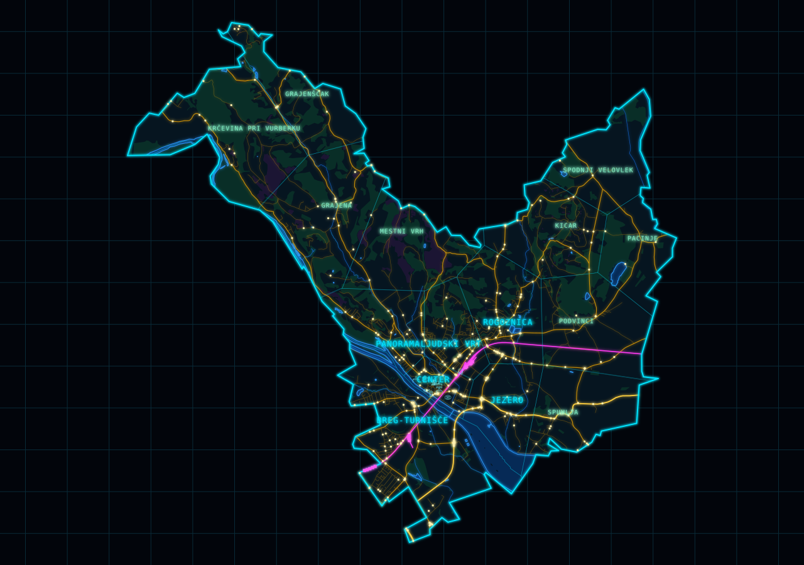

# Ptuj

A neon vector map of the Municipality of Ptuj in three.js with: 

1) its real outline,
2) quarters, 
3) the Drava and 
4) Ptujsko jezero, 
5) roads, 
6) railway and 
7) landmarks, 
8) with simulated road traffic (dots) 
9) and trains (squares).

Drag to move, right drag to turn and tilt, scroll to zoom to the pointer, click a spot to center it; `inkscape-scripts/project.sh all` rebuilds `src/map/ptuj.json`, and the icons in `src/icons` are SVG for Inkscape.

Map data © [OpenStreetMap](https://www.openstreetmap.org/copyright) contributors, available under the [ODbL](https://opendatacommons.org/licenses/odbl/). The quarter borders are approximate.

## License

MIT
