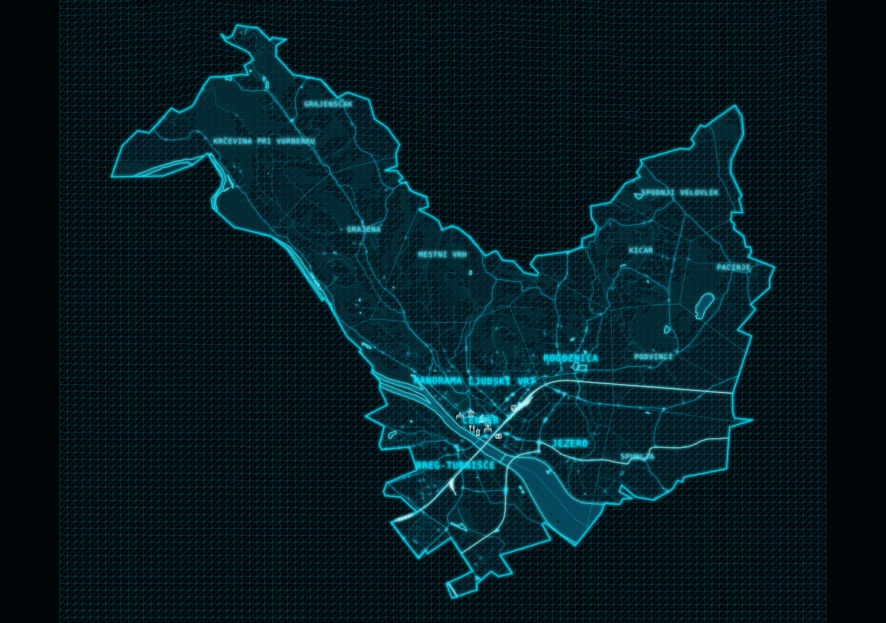

# Ptuj

A retro-futuristic cyan wireframe map of the Municipality of Ptuj, in the style of the vector screens of the 80s and 90s, with:

1. its real outline,
2. quarters and villages,
3. the Drava and
4. Ptujsko jezero,
5. woods, vineyards and parks,
6. roads,
7. railway and
8. landmarks,
9. with simulated road traffic (wireframe cars)
10. and trains (wireframe wagons),
11. all over the low poly hills of the real terrain (raised twice), drawn as a faint wireframe of flat shaded triangles, with the hills hiding the lines, places and names behind them,
12. with every place shown as a slowly turning 3D wireframe model; point at one for its address, operator, opening hours, phone and website,
13. and the employers on the Employment Service of Slovenia's list of bans on employing foreigners marked: their model glitches into a skull now and again while a ban holds, and their details end with the date it runs to. A place is marked only when its OpenStreetMap address and a distinctive word of the employer's registered name both match the list (`python3 inkscape-scripts/osm/bans.py inkscape-scripts/osm/data` lists the matches).

You move over it as in a first person game: click a spot to look at it and scroll to zoom to it, drag to look around, right drag to move, W A S D or the arrows to walk, E and Q to rise and sink, Shift to hurry, double click to fly nearer and Esc for the whole map. On a touchscreen, one finger looks around and two pinch and move.

`inkscape-scripts/project.sh all` rebuilds `src/map/ptuj.json` from OpenStreetMap (with the list of bans) and `src/map/terrain.json` from elevation tiles (`project.sh terrain` only the latter, which needs Pillow). `project.sh preview` draws the map with Inkscape into the picture below, using the SVG icons in `src/icons`.

Map data © [OpenStreetMap](https://www.openstreetmap.org/copyright) contributors, available under the [ODbL](https://opendatacommons.org/licenses/odbl/). The quarter borders are approximate.

Bans on employing foreigners from the [Employment Service of Slovenia](https://www.ess.gov.si/delodajalci/zaposlovanje-tujcev/) (Zavod RS za zaposlovanje).

Elevation from [Mapzen Terrain Tiles](https://registry.opendata.aws/terrain-tiles/): Europe terrain data produced using Copernicus data and information funded by the European Union - EU-DEM layers; SRTM and GMTED2010 terrain data courtesy of the U.S. Geological Survey.

## License

MIT
