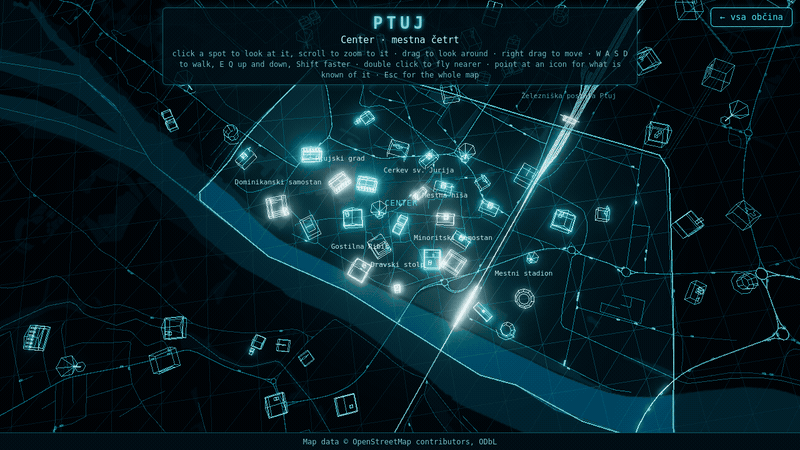

# Ptuj

A retro-futuristic cyan wireframe map of the Municipality of Ptuj, in the style of the vector screens of the 80s and 90s. It runs in the browser on desktops, phones and tablets.

**[Open the map](https://aljazmc.github.io/ptuj-preview/)** · [Source code](https://github.com/aljazmc/threejs-landscapes/tree/main/packages/ptuj)

## On the map

- the municipality's real outline, its quarters and villages
- the Drava, Ptujsko jezero, woods, vineyards and parks
- roads, the railway and landmarks
- simulated road traffic (wireframe cars) and trains (wireframe wagons)
- the low poly hills of the real terrain, raised twice, as a faint wireframe of flat shaded triangles. The hills hide the lines, places and names behind them.
- every place as a slowly turning 3D wireframe model. Point at one for its address, operator, opening hours, phone and website.
- the employers on the Employment Service of Slovenia's list of bans on employing foreigners. While a ban holds, the place's model glitches into a skull now and again, and its details end with the date the ban runs to. A place is marked only when its OpenStreetMap address and a distinctive word of the employer's registered name both match the list.

## Keyboard and mouse

| Mouse / key       | Action                                              |
| ----------------- | --------------------------------------------------- |
| click             | look at that spot and choose its quarter or village |
| wheel             | zoom toward the spot in the middle of the view      |
| double click      | fly a third of the way to the spot                  |
| left drag         | look around                                         |
| right/middle drag | move over the map                                   |
| W A S D, arrows   | walk                                                |
| E, Q              | rise, sink                                          |
| Shift             | hurry                                               |
| point at an icon  | what is known of the place                          |
| Esc               | back to the whole map                               |

## Touchscreens

| Touch                       | Action                                                                  |
| --------------------------- | ----------------------------------------------------------------------- |
| tap                         | look at that spot and choose its quarter or village                     |
| one finger                  | drag to look around                                                     |
| two fingers                 | pinch to zoom toward the ground between them, drag to move over the map |
| slide a finger over an icon | what is known of the place                                              |
| ← vsa občina                | back to the whole map                                                   |

Tips for phones and tablets:

- **Pinch where you want to go.** The zoom heads for the ground between your fingers, so put them around the spot you want to see closer.
- **Lost?** Once you have tapped a quarter or village, the _← vsa občina_ button flies back to the view of the whole municipality.
- **Behind a hill.** Places hidden behind hills can't be pointed at. Move a little with two fingers to see them.

## Credits

Map data © [OpenStreetMap](https://www.openstreetmap.org/copyright) contributors, available under the [ODbL](https://opendatacommons.org/licenses/odbl/). The quarter borders are approximate.

Bans on employing foreigners from the [Employment Service of Slovenia](https://www.ess.gov.si/delodajalci/zaposlovanje-tujcev/) (Zavod RS za zaposlovanje).

Elevation from [Mapzen Terrain Tiles](https://registry.opendata.aws/terrain-tiles/): Europe terrain data produced using Copernicus data and information funded by the European Union - EU-DEM layers; SRTM and GMTED2010 terrain data courtesy of the U.S. Geological Survey.

Built with [three.js](https://threejs.org/), [React](https://react.dev/) and [React Three Fiber](https://r3f.docs.pmnd.rs/).

## License

The code is [MIT](https://github.com/aljazmc/threejs-landscapes/blob/main/LICENSE). The map data stays under the ODbL.
